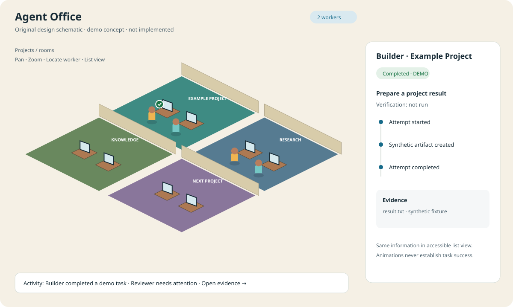

# Agent Office

A browser-based, isometric office for working with AI agents across projects, providers and runtimes.

**Status: specification and implementation handoff. There is no runnable application yet.**
This repository intentionally defines what to build before an implementation agent starts. No provider credentials are required to read or validate it.

[Español](README.es.md) · [Start implementing](IMPLEMENTATION.md) · [Product requirements](docs/product/requirements.md) · [Visual design](design.md) · [Architecture](docs/architecture.md)



## The idea

Projects occupy rooms. Agents appear as workers at desks. Their tasks, approvals, handoffs and results are visible in a live office. Clicking a worker opens the evidence behind its state. A searchable knowledge area preserves decisions across sessions.

The office is a useful representation of real work: an animation never proves a task is running, finished, tested or deployed. A disconnected worker is shown as disconnected. Demo events are unmistakably labelled.

Visual direction: the management readability of Prison Architect and the isometric office feel of Game Dev Tycoon, expressed through original artwork and interaction design. No assets, logos or proprietary code from those games are included.

## Intended capabilities

- Multiple projects, rooms, agents and tasks, with independent workspaces and permissions.
- Provider-neutral model connections through adapters; local endpoints and remote services.
- Separate runtime adapters for externally running agents. Hermes is optional.
- Live activity, approvals, artifacts, costs when reported, reconnect and honest error states.
- An accessible list/board equivalent to the office scene, including keyboard and mobile use.
- Plain Markdown knowledge, with optional Obsidian interoperability.
- A deterministic demo that works without any account, credential, subscription or model call.

These are requirements, not features already shipped. See the [scope and acceptance criteria](docs/product/requirements.md).

## Hand this to an implementation agent

Read [AGENTS.md](AGENTS.md), then [IMPLEMENTATION.md](IMPLEMENTATION.md). They define reading order, staged delivery, acceptance evidence and the first vertical slice. Work through [the backlog](docs/backlog.md) without claiming later milestones are implemented.

Validate this handoff today:

```sh
python3 scripts/check_spec.py
```

The checker validates documentation links, JSON references and the example event lifecycle. It does not run the future application or perform full JSON Schema validation.

## Planned stack

TypeScript monorepo; React/Vite for panels; PixiJS for an isometric 2D scene; Node.js LTS/Fastify for the API; SQLite for the initial single-host edition; SSE for event delivery. These are recorded engineering decisions, not installed dependencies. See [ADRs](docs/adr/0001-foundation.md). A dependency manifest and lockfile are deliberately left to milestone M0, when compatible maintained versions can be installed together.

## Repository map

| Location | Purpose |
|---|---|
| `docs/product/` | Users, scope, real workflows and acceptance criteria |
| `design.md`, `docs/assets/` | Visual/interaction contract and original schematic |
| `docs/architecture.md`, `docs/adapters.md` | Boundaries, integration capabilities and limitations |
| `contracts/` | Versioned event/configuration JSON Schemas and protocol |
| `examples/` | Synthetic configuration and deterministic event fixtures |
| `docs/backlog.md`, `docs/testing.md` | Ordered implementation and observable evidence |
| `docs/ai-team/` | Portable state and handoff templates for future sessions |

## Open development

[MIT license](LICENSE). See [CONTRIBUTING.md](CONTRIBUTING.md) and [SECURITY.md](SECURITY.md).
This repository does not depend on a particular company's infrastructure, a paid AI subscription, Hermes, Obsidian or a developer's home directory.
